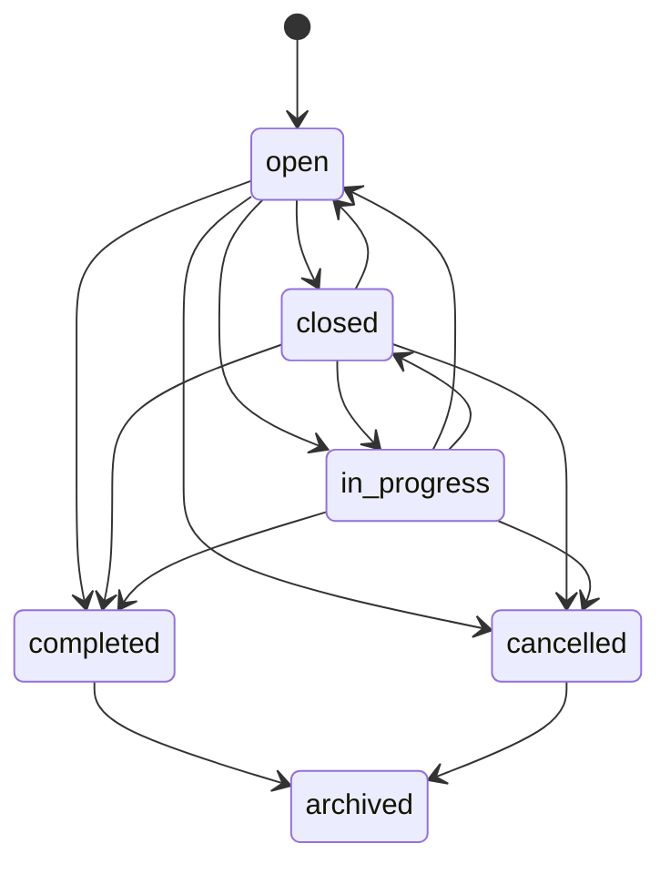

# Team Dashboard and collaboration

A lead enters the dashboard when they publish a project. An invitee enters when they accept. An applicant who stays on Applications enters when polling detects approval. Returning members can use their approved application, accepted invitation, approval notification or project detail link. Leads also have a link on My Projects. The route is `/projects/[id]/workspace`. The `tab` query parameter selects Overview, Chat, Updates or Tickets.

## Overview and lifecycle

The project owner and memberships with `left_at IS NULL` have access. Pending applicants, pending invitees and former members cannot read or mutate the dashboard. Team size includes the lead. For example, the lead and one approved member can start a four-person project at **Team: 2 of 4**. A database function, `minimum_start_members()`, sets the minimum number of other active members. The overview RPC supplies the same value to the Start project button. Confirming Start moves an open project to In progress and alerts the active members. The project stores the first start time and lead ID. Reopening recruitment preserves these fields. Earlier start dates are unknown for projects already underway at migration time.

Only Open recruits. Closed and In progress preserve pending participation. Completed, Cancelled and Archived resolve pending participation and make chat, updates, tickets and project editing read-only. Members can leave, leads can remove or reassign active members, and transfer of leadership requires consent from an active member with Lead intent. Leaving or removal releases the slot, unassigns tickets and preserves membership history.

## Chat

Choose Everyone or select one or more teammates under Recipients. A sorted participant set identifies each private conversation, so replies from either side land in the same thread. The conversation list displays the viewer's unread count for each thread. Text is rendered as text. Authors can edit or remove their messages. A project lead has the same private-message access as any other teammate.

Chat uses optimistic sends with a stable UUID for retries, 50-message history pages, incremental edit/removal polling and a per-viewer, per-conversation read timestamp. Reads enforce active membership and audience both through RLS and in every privileged read path. The Everyone audience includes active members who join later. Existing messages retain their IDs, text and timestamps and receive the Everyone audience.

## Updates and tickets

Any active teammate can post a work update of up to 4,000 characters. The author can edit or delete it. Posting creates one notification per other active teammate, including the lead, with the author's name and a link to Updates. Message sends are limited to 25 per minute. Posting updates is subject to a 12-per-minute limit. Notification deduplication and record writes happen in the same transaction.

Tickets support Issue, Feature, Modification, Improvement and Question, with a title, description, low/medium/high priority and optional active-team assignee. Filter by type, status, priority and assignee. Active members can advance Open → In progress → Resolved → Closed or reopen a resolved or closed ticket. Creation alerts the lead and assignee. Status changes alert the creator and assignee while they have access. Actors do not receive notifications about their own action, and overlapping recipients get a single notification.

## API and storage

| Operation | Endpoint or relation |
| --- | --- |
| Dashboard reads | `GET /api/projects/[id]/workspace?resource=overview\|unread\|conversations\|messages\|updates\|tickets` |
| Message pagination | `thread` (Everyone or sorted participant IDs), `before`, `before_id`, `after` sequence |
| Dashboard writes | `POST /api/projects/[id]/workspace` with a Zod-validated action, same-origin check, verified session, rate limit and server-only actor RPC |
| Chat | `project_messages`, `workspace_read_state` |
| Work updates and tickets | `project_updates`, `project_tickets` |
| Membership and consent | `project_members`, `ownership_transfers`, `projects.started_at`, `projects.started_by` |
| Inbox | `GET/POST /api/notifications`, `GET /api/notifications/unread-count`, recipient-only `notifications` |
| Profile metadata and public projection | `GET/POST /api/profile-metadata`, `GET /api/profiles/[id]`, `/u/[id]` |

The bell supports a recent list and unread count. The full inbox supports pagination, unread filtering and mark-all-read. Participation, membership, ownership, status, update and ticket events create notifications. Chat uses conversation read counts. Paused background-tab polling resumes when the page becomes visible.

## Profile privacy and links

Default visibility is Team-only / Private, signed-in users only. Full profiles are visible to their owner, active shared-project contacts and the other party in an application/invitation relationship (including historical records). Public means any verified signed-in user; anonymous viewing is unavailable. Minimal name/avatar identity remains available in the directory and participation UI. Find Talent includes only profiles its lead is authorized to view. Email, storage keys, vectors and traces are excluded from the public projection. Open work and permitted completed/archived work can appear on profiles; other nonterminal projects require viewer team access.

Find Talent therefore excludes unrelated existing private profiles. A new lead may initially see no candidates until members opt into Public or establish an allowed application/invitation/shared-project relationship. Candidates must also have Member intent, completed onboarding and a stored embedding with the same model/version as the selected role. The current project's active members and the lead are excluded. Shared-project contacts from another project can qualify. Eligible candidates retain stored-vector cosine ordering; no embedding is generated and no minimum score gates eligibility. The normal API returns the existing percentage/skill-overlap projection rather than raw vectors or cosine. No profile becomes public automatically.

All link fields start empty. Bare hosts normalize to HTTPS. Unsafe/insecure schemes, credentials, invalid hosts, oversized values and incorrect GitHub/LinkedIn hosts fail validation. Three custom label/URL pairs are allowed. New-tab links use `noopener noreferrer`. The metadata endpoint updates only links/visibility and never calls the embedding provider, canonical builder or embedding-save RPC.

## Current scope and limitations

Conversation membership is fixed by the chosen participant set. Changing recipients opens a different thread. Private conversations are scoped to one team. Chat and updates support plain text. Attachments, threaded replies, mentions, push/email delivery, ticket comments, cross-project messaging, payments, ratings and admin moderation are outside the current scope. Ticket and update lists currently load the project's full list. Changes made in another browser appear on the next poll. A user who has already read content can retain their own copy.

Use the [dashboard verification report](team-dashboard-verification.md) for migration, backup, catalog, test and cleanup results.

## Personal Dashboard

The personal landing page at `/dashboard` links to exact team conversations and shows notifications related to the viewer's active projects. Its private-message feed applies current membership and audience checks. Daily notes, DND and focus statistics belong to the individual user. See the [personal Dashboard guide](personal-dashboard.md).
